# 🎓 ZYREN AI Tutor — Real-Time Multimodal Socratic Learning Platform

<div align="center">


<p align="center">
  <b>A state-of-the-art, real-time Socratic AI tutoring workstation combining bidirectional low-latency voice streaming, computer vision screen perception, an intelligent digital blackboard, deterministic diagram auto-layout, vector Venn diagrams, and a cutting-edge 3D WebGL Marching Cubes geometry engine.</b>
</p>

[Key Features](#-key-features) • [Architecture](#-system-architecture) • [3D & Geometry Engine](#-3d-mathematical-geometry-engine) • [Quick Start](#-quick-start) • [Configuration](#-configuration) • [Testing](#-testing--quality-assurance)

</div>

---

## 🌟 Overview

**ZYREN AI Tutor** is an autonomous, real-time pedagogical pair-learning workstation engineered for university and advanced secondary education across Mathematics, Physics, Computer Science, Engineering, Medicine, and Humanities.

Unlike conventional chatbots or disjointed speech interfaces, **AI Tutor** acts as a genuine classroom instructor standing in front of a digital blackboard:
- **Speaks and Listens Simultaneously**: Full-duplex conversation with zero awkward pauses, immediate interruptibility, and 30 distinct vocal personas powered by Google Gemini Live Realtime.
- **Multimodal Perception**: Sees student screen-shares, camera feeds, pasted screenshots, and uploaded PDF/image assignments in real time.
- **Dynamic Board Drawing**: Real-time chalk handwriting, step-by-step LaTeX formula typesetting, interactive 2D calculus curves with shaded definite integrals, deterministic concept trees and flowcharts, vector Venn diagrams, and interactive 3D WebGL solids with orbit controls.
- **Pedagogical Scaffolding**: Built around the Socratic method and cognitive code-switching — guiding students turn-by-turn with targeted micro-steps rather than handing out unearned answers.

---

## 🏛 System Architecture

The platform runs as a coordinated tripartite system managed by an autonomous Python launcher (`main.py`):

```mermaid
flowchart TB
    subgraph Client ["🖥️ Modern Web Frontend (React 18 + Vite + TypeScript)"]
        UI["Interactive Blackboard Canvas (1080p Virtual World)"]
        GLOverlay["3D WebGL Card (Three.js + Marching Cubes)"]
        GraphOverlay["2D Calculus Engine (Area Shading & Function Plot)"]
        VennEngine["Vector Venn Overlay (SVG Boolean Masks)"]
        DiagramEngine["DiagramLayoutEngine (Trees, Flowcharts, Comparisons)"]
        SyncEngine["SyncEngine (Speech-to-Stroke Clock Alignment)"]
        VisionStream["Screen Share & File Ingestion Pipeline"]
    end

    subgraph Transport ["📡 Real-Time WebRTC Media Fabric (LiveKit Server)"]
        AudioTrack["Bidirectional Opus Audio Stream (<200ms latency)"]
        VideoTrack["H.264 / VP8 Screen & Webcam Stream"]
        DataChannel["Reliable Bidirectional JSON DataChannel"]
    end

    subgraph Agent ["🤖 AI Tutor Worker (Python 3.10+ & LiveKit Agents)"]
        TutorCore["Socratic Tutor Agent Core"]
        PromptEngine["5-Mode Multilingual Matrix & Code-Switching Engine"]
        ToolExecutor["Atomic Whiteboard Tool Handlers"]
        GeminiWS["Google Gemini Live Realtime WebSocket Session"]
    end

    Client <-->|"Audio I/O"| AudioTrack
    Client -->|"Video / Frame Capture"| VideoTrack
    Client <-->|"Board State, Slide Deck & Actions"| DataChannel

    AudioTrack <-->|"Realtime Audio"| TutorCore
    VideoTrack -->|"Multimodal Vision"| TutorCore
    DataChannel <-->|"Tool Calls & Board Sync"| ToolExecutor

    TutorCore <-->|"Bidirectional Realtime Stream"| GeminiWS
    ToolExecutor -->|"Scheduled Draw Commands"| DataChannel
    SyncEngine -->|"Render Operations"| UI
    SyncEngine -->|"3D Meshes"| GLOverlay
    SyncEngine -->|"2D Curves & Shading"| GraphOverlay
    SyncEngine -->|"Venn Masks"| VennEngine
    SyncEngine -->|"Auto Layout"| DiagramEngine
```



### ⚡ Unified Orchestrator (`main.py`)
Launch the entire ecosystem with a single terminal command:
```bash
python main.py
```
`main.py` automatically:
1. Validates `.env` and checks for your `GEMINI_API_KEY`.
2. Launches the local **LiveKit WebRTC Server** (`--dev` mode on port `7880`).
3. Starts the **Python Voice Agent** worker in its isolated virtual environment with live auto-reload.
4. Boots the **Vite Dev Server** (port `5173`) and checks dependencies.
5. Launches your default web browser and displays both Localhost and LAN/Mobile network URLs.
6. Gracefully terminates all background sub-processes on `Ctrl+C`.

---

## ✨ Key Features

### 🎙️ 1. Ultra-Low Latency Conversational Voice & Dynamic Model Selection
- **Gemini Live Realtime Streaming**: Instant conversational turn-taking with sub-second response times.
- **Dynamic Mid-Session Model Switcher**:
  - `gemini-3.8-live-extended-thinking` (Configurable thinking levels: `low`, `medium`, `high`)
  - `gemini-3.8-live` (Ultra-low latency streaming voice)
  - `gemini-3.1-flash-live-preview` (Agile multimodal preview with thinking depth)
- **Zero-Disconnection Voice Switching**: Audition and switch between **30 Gemini vocal personas** (Aoede, Puck, Charon, Kore, Fenrir, Zephyr, etc.) mid-call with instant audio preview playback and favorites filtering.
- **Turn-0 Memory Reset**: Hard reset of Gemini Live WebSocket and agent memory without reloading the page.

### 👁️ 2. Real-Time Multimodal Vision & File Ingestion
- **Continuous Visual Awareness**: Real-time perception of screen shares, webcams, code editors, and textbooks.
- **Multimodal File Upload**: Drag-and-drop or upload PDF exercises, textbook chapters, and high-res assignment photos directly into the Chat Drawer.
- **Clipboard Paste (Ctrl+V)**: Paste homework screenshots or diagrams directly from your clipboard to immediately prompt the tutor.

### 📐 3. Smart 3D WebGL Mathematical Geometry Engine
- **Marching Cubes Volumetric Meshing**: Real-time rendering of implicit quadric surfaces and CSG intersections (e.g. $9 \le x^2 + y^2 + z^2 \le 16$, Steinmetz solids, ellipsoids, hyperboloids).
- **Feature-Preserving Meshing**: Exact sub-voxel zero-crossing root finding and QEF singularity resolution to eliminate floating artifacts and ghost blobs.
- **Parametric Manifolds**: Vector manifold builders for Möbius strips, Toruses, Trefoil knots, and Klein bottles.
- **Solids of Revolution & Extrusions**: Dynamic revolves around $X, Y, Z$ axes and linear bounded extrusions with closed, watertight capped ends.
- **Watertight Clipping Planes**: Real-time cross-section slicing ($x \ge 0, z \le 2$).
- **Isolated 3D OrbitControls**: Pan, rotate, and zoom 3D graphs directly inside their whiteboard cards without disrupting canvas navigation.

### 📊 4. Deterministic Diagram & Venn Engines
- **`DiagramLayoutEngine`**:
  - Deterministic auto-layout for concept maps, taxonomy trees, hierarchical flowcharts, and comparison boards.
  - Dynamic font measurement and auto-sizing node boxes to eliminate text overflow.
  - 90° orthogonal elbow connectors and mid-diagram directional turns (`down`, `right`, `left`).
  - Compound diagram composition with `attachToNode`.
- **`VennOverlay`**:
  - High-precision 2-set and 3-set Venn diagrams rendered with native SVG Boolean masking (`<clipPath>`, `<mask>`).
  - Exact shading for any boolean set operation ($P(A \cap B)$, $P(A \cup B)$, $P(A \setminus B)$, $P(A')$, neither, etc.).
  - Set labels and probability minterms positioned at calculated geometric centroids.

### 📈 5. Calculus 2D Graphing with Area Shading
- Interactive Cartesian coordinate system with auto-scaling bounds.
- Function graphing for polynomials, trigonometric, exponential, and rational curves.
- **Definite Integral Area Shading**: Highlights integration regions between $f_{\text{top}}(x)$ and $f_{\text{bottom}}(x)$ over $[a, b]$ with area evaluation.
- **Statistical Distributions**: Normal / Gaussian probability density curves with shaded tails and confidence intervals.

### 📝 6. Synchronized Digital Blackboard & Slide Deck
- **KaTeX LaTeX Typesetting**: Renders math expressions, integrals, matrices, fractions, and boxed answers.
- **Simulated Handwriting**: Stroke-by-stroke handwriting animation synchronized with vocal speech.
- **Writing Style Selector**: Seamlessly switch between Handwriting (`Caveat`), Normal Typography (`Inter`), or Mixed Mode.
- **PowerPoint-Style Slide Deck**: Create, rename, duplicate, reorder, and clear slides; inspect whiteboard history with `inspect_whiteboard`.
- **Session Export**: Export the entire lesson to multi-page **PDF** or high-resolution **PNG**.
- **User Drawing Tools**: Integrated student pen, highlighter, text, and eraser layer.

### 🌐 7. Multilingual Matrix (5 Pedagogical Modes)
Specialized for bilingual language schools (IGCSE / American / STEM / Abitur / Thanaweya Amma):
1. **Egyptian Arabic + German Context**: Egyptian Arabic syntax with 100% German for technical terminology and academic concepts.
2. **Egyptian Arabic + English Context**: Egyptian Arabic syntax with 100% English for all mathematics, science, equations, and operational verbs.
3. **English Only**: Pure international English instruction.
4. **German + English Context**: English conversational syntax with German technical terms.
5. **German Only**: Pure German immersion.

---

## 📂 Project Structure

```
AI_Tutor/
├── agent/                          # Python AI Tutor Voice Agent & Worker
│   ├── agent.py                    # TutorAgent class, tools & Gemini Live integration
│   ├── requirements.txt            # Python dependencies (livekit-agents, google-genai, etc.)
│   └── venv/                       # (Git-ignored) Virtual environment
├── livekit_server/                 # Pre-compiled LiveKit WebRTC Server
│   ├── livekit-server.exe          # Local development binary
│   └── LICENSE                     # Apache 2.0 License
├── public/                         # Public assets (icons, favicons)
├── src/                            # Frontend React 18 + TypeScript Application
│   ├── adapters/                   # Architectural abstraction layers
│   │   ├── canvas/                 # Rough.js & 2D canvas drawing adapters
│   │   ├── llm/                    # Gemini adapter interfaces
│   │   └── tts/                    # ElevenLabs & TTS preview adapters
│   ├── components/                 # React UI components
│   │   ├── ChatDrawer.tsx          # Real-time chat & multimodal file uploader
│   │   ├── FileMenu.tsx            # Save/Open, PDF/PNG export menu
│   │   ├── FloatingVideoPiP.tsx    # Picture-in-Picture webcam & screen video
│   │   ├── ModelSelectorModal.tsx  # Dynamic Gemini Live model & thinking level modal
│   │   ├── SlidePanel.tsx          # Slide deck drawer & thumbnail management
│   │   ├── ThreeGraph3DCard.tsx    # 3D Three.js card with isolated OrbitControls
│   │   ├── UserDrawingLayer.tsx    # Student freehand annotation canvas
│   │   ├── VoiceSelectorModal.tsx  # 30-voice persona audition & selector modal
│   │   └── Whiteboard.tsx          # Master blackboard workspace orchestrator
│   ├── engine/                     # Core computational & synchronization engines
│   │   ├── AudioClock.ts           # Web Audio clock source & drift calculator
│   │   ├── CollisionDetector.ts    # Two-column layout solver & collision avoidance
│   │   ├── DiagramLayoutEngine.ts  # Deterministic tree, flowchart & comparison auto-layout
│   │   ├── DriftCorrector.ts       # Audio-visual synchronization drift compensator
│   │   ├── InterruptionHandler.ts  # Millisecond vocal interruption recovery
│   │   ├── SyncEngine.ts           # Master render dispatcher & undo/redo stack
│   │   └── SyncQueue.ts            # Priority command queue
│   ├── layers/                     # Canvas visual overlays
│   │   ├── ArabicShaper.ts         # RTL Arabic text shaping & glyph normalization
│   │   ├── CanvasLayer.tsx         # Rough.js sketchy blackboard drawings
│   │   ├── Graph3DOverlay.tsx      # 3D WebGL container overlay
│   │   ├── GraphOverlay.tsx        # 2D coordinate graphs & calculus area shading
│   │   ├── MathOverlay.tsx         # KaTeX LaTeX formula renderer
│   │   ├── SVGOverlay.tsx          # Stroke-by-stroke animated handwriting
│   │   └── VennOverlay.tsx         # Vector SVG boolean mask Venn diagram engine
│   ├── math3d/                     # Mathematical 3D geometry engine
│   │   ├── builders/               # Surface, revolution, parametric & solid builders
│   │   ├── marchingCubes/          # 3D Marching Cubes algorithm & lookup tables
│   │   ├── astParser.ts            # AST algebraic expression parser
│   │   ├── compiler.ts             # High-speed math function compiler
│   │   ├── expressionGuard.ts      # Math safety & evaluation validator
│   │   ├── implicitResolver.ts     # Implicit-to-explicit equation resolver
│   │   ├── multiBoundarySolver.ts  # Multi-constraint spatial domain solver
│   │   └── router.ts               # 3D plot type routing logic
│   ├── store/                      # Zustand state store
│   ├── transport/                  # LiveKit WebRTC client & DataChannel protocol
│   ├── types/                      # Shared TypeScript type definitions
│   ├── App.tsx                     # Top-level React entrypoint & token lifecycle
│   ├── index.css                   # Global blackboard styling & Tailwind classes
│   └── main.tsx                    # React DOM root
├── tests/                          # Automated test suites
│   ├── agent/                      # Pytest agent & MLF instruction tests
│   │   ├── test_agent.py           # Agent async tool execution test
│   │   └── test_mlf_instructions.py# Multilingual matrix prompt validation
│   └── unit/                       # Vitest frontend unit tests
│       ├── diagram_layout.test.ts  # DiagramLayoutEngine unit test suite (22 tests)
│       ├── graph_shading.test.ts   # 2D calculus area shading test suite (5 tests)
│       └── venn_diagram.test.ts    # VennOverlay boolean masking test suite (14 tests)
├── .env.example                    # Environment configuration template
├── .gitignore                      # Git exclusion rules
├── index.html                      # HTML template
├── main.py                         # Unified platform launcher script
├── package.json                    # Node dependencies & npm scripts
├── run.bat                         # Quick launch batch script for Windows
├── tsconfig.json                   # TypeScript project configuration
└── vite.config.ts                  # Vite build & LiveKit token server config
```

---

## 🚀 Quick Start

### 📋 Prerequisites
Ensure your machine has the following installed:
- **Node.js**: v18.0.0 or higher ([Download Node.js](https://nodejs.org/))
- **Python**: v3.10, v3.11, or v3.12 ([Download Python](https://www.python.org/))
- **Google Gemini API Key**: Free or paid key from [Google AI Studio](https://aistudio.google.com/)

---

### 1️⃣ Clone the Repository
```bash
git clone https://github.com/MONaser04/Zyren-AI-Tutor.git
cd Zyren-AI-Tutor
```

### 2️⃣ Configure Environment Variables
Copy the template `.env.example` to `.env`:
```bash
cp .env.example .env
```
Open `.env` in any text editor and insert your Gemini API Key:
```ini
LIVEKIT_URL=ws://127.0.0.1:7880
LIVEKIT_API_KEY=devkey
LIVEKIT_API_SECRET=secret
GEMINI_API_KEY=AIzaSy...your_actual_gemini_api_key...
```

### 3️⃣ Install Dependencies

#### Frontend (Node.js)
```bash
npm install
```

#### Voice Agent (Python)
It is recommended to use a virtual environment:
```bash
# Create virtual environment inside agent folder
python -m venv agent/venv

# Activate virtual environment
# Windows (PowerShell):
agent\venv\Scripts\Activate.ps1
# Windows (CMD):
agent\venv\Scripts\activate.bat
# Linux / macOS:
source agent/venv/bin/activate

# Install required Python packages
pip install -r agent/requirements.txt
```

---

### 4️⃣ Launch AI Tutor!
Start all services (LiveKit Server + Python Voice Agent + Vite Frontend) with a single command:
```bash
python main.py
```
*Windows users can also double-click `scripts/run.bat`.*

The launcher will initialize all three components, start the LiveKit RTC server, establish connection channels, and automatically launch your browser to:
```
http://localhost:5173
```
If you wish to run on a tablet or mobile phone on the same Wi-Fi network, access the LAN URL printed in the console (e.g., `http://192.168.1.X:5173`).

---

## ⚙️ Environment Configuration

| Variable | Default Value | Description |
|---|---|---|
| `LIVEKIT_URL` | `ws://127.0.0.1:7880` | WebSocket URL of the LiveKit WebRTC server (`wss://...` for LiveKit Cloud). |
| `LIVEKIT_API_KEY` | `devkey` | LiveKit API Key (`devkey` for local development). |
| `LIVEKIT_API_SECRET` | `secret` | LiveKit API Secret (`secret` for local development). |
| `GEMINI_API_KEY` | *(Required)* | Google Gemini API Key from [Google AI Studio](https://aistudio.google.com/). |

---

## 🧮 3D Mathematical Geometry Engine

The AI Tutor digital blackboard includes a high-performance **3D WebGL geometry engine** built on top of Three.js and custom mathematical algorithms:

```
                          ┌──────────────────────────┐
                          │   Natural Language /     │
                          │   Algebraic Equation     │
                          └─────────────┬────────────┘
                                        │
                                        ▼
                          ┌──────────────────────────┐
                          │    AST Math Compiler     │
                          │ (expressionGuard.ts)     │
                          └─────────────┬────────────┘
                                        │
        ┌───────────────────────────────┼───────────────────────────────┐
        ▼                               ▼                               ▼
┌───────────────┐              ┌────────────────┐              ┌────────────────┐
│ Marching      │              │ Parametric     │              │ Solids of      │
│ Cubes Engine  │              │ Manifold       │              │ Revolution     │
│ (Implicit     │              │ (Torus, Möbius,│              │ & Extrusions   │
│ Solids & CSG) │              │ Vector Fields) │              │ (Watertight)   │
└───────┬───────┘              └────────┬───────┘              └────────┬───────┘
        │                               │                               │
        └───────────────────────────────┼───────────────────────────────┘
                                        │
                                        ▼
                          ┌──────────────────────────┐
                          │ ThreeGraph3DCard (WebGL) │
                          │  - Isolated OrbitControls│
                          │  - Watertight Clipping   │
                          │  - Adaptive Grid Jitter  │
                          └──────────────────────────┘
```

### Supported 3D Plot Types
1. **Implicit Solids & CSG Intersections** (`plot_type='bounded_surfaces'`):
   - Marching Cubes algorithm across a $64^3$ voxel grid.
   - Exact sub-voxel zero-crossing root finding and QEF singularity resolution.
   - Evaluates complex inequalities like $9 \le x^2 + y^2 + z^2 \le 16$, intersecting cylinders, and Cayley cubics.
2. **Parametric Manifolds** (`plot_type='parametric'`):
   - Computes parametric vector equations $r(u, v) = \langle x(u,v), y(u,v), z(u,v) \rangle$.
3. **Solids of Revolution** (`plot_type='solid_of_revolution'`):
   - Revolve 2D curves $y = f(x)$ around $X, Y,$ or $Z$ axes with custom angles and watertight end caps.
4. **Linear Extrusions** (`plot_type='linear_extrusion'`):
   - Extrude bounded 2D planar domains between $f_{\text{top}}$ and $f_{\text{bottom}}$ into 3D space.
5. **Single-Valued Heightfields** (`plot_type='surface'`):
   - Direct graph of $z = f(x, y)$ with optional 2D domain masks.

---

## 📡 Data Channel Protocol

The client and agent communicate bidirectionally using reliable WebRTC JSON packets:

### Client → Agent
```json
{
  "type": "board_state_sync",
  "payload": {
    "sessionTitle": "Calculus - Volume of Revolution",
    "totalSlides": 2,
    "activePageIndex": 0,
    "currentSlide": {
      "title": "Disk Method",
      "mathEquations": ["V = \\pi \\int_0^2 (4 - x^2)^2 dx"],
      "graphs2D": [],
      "graphs3D": [{ "title": "Paraboloid of Revolution" }]
    }
  }
}
```
*Also supports: `change_voice`, `change_model`, `reset_ai_memory`, `user_prompt`, and `file_upload`.*

### Agent → Client (Tool Commands)
```json
{
  "type": "shape",
  "shapeType": "graph3d",
  "x": 1000,
  "y": 180,
  "width": 640,
  "height": 480,
  "options": {
    "title": "Spherical Shell Cutaway",
    "plotType": "bounded_surfaces",
    "equationZ": "9 <= x^2 + y^2 + z^2 <= 16",
    "clippingPlane": "x >= 0",
    "colorTheme": "cyan_orange"
  }
}
```

---

## 🧪 Testing & Quality Assurance

AI Tutor enforces strict quality assurance with automated test suites across both frontend and backend layers:

### 1. Frontend Test Suite (Vitest)
Executes 53 unit tests validating the deterministic layout solver, SVG Venn masks, 2D calculus area shading, and AST math expression safety:
```bash
npm test
```
```
 ✓ tests/unit/diagram_layout.test.ts (22 tests)
 ✓ tests/unit/venn_diagram.test.ts (14 tests)
 ✓ tests/unit/graph_shading.test.ts (5 tests)
 ✓ src/math3d/expressionGuard.test.ts (12 tests)

 Test Files  4 passed (4)
      Tests  53 passed (53)
```

### 2. Frontend Production Build Check
```bash
npm run build
```
Validates full TypeScript typing (`tsc -b`) and bundles production assets via Vite.

### 3. Backend Agent Test Suite (Pytest)
Validates asynchronous tool calls and prompt multilingual matrix integrity:
```bash
# In active Python virtual environment:
pytest tests/agent/
```
```
collected 2 items
tests/agent/test_agent.py .           [ 50%]
tests/agent/test_mlf_instructions.py . [100%]
===================== 2 passed in 9.72s =====================
```

---

## 🤝 Contributing

Contributions are welcomed! Follow these steps to contribute:
1. **Fork the repository** on GitHub.
2. **Create a feature branch**:
   ```bash
   git checkout -b feature/amazing-feature
   ```
3. **Commit your changes** using conventional commits:
   ```bash
   git commit -m "feat: Add interactive geometry compass tool"
   ```
4. **Push to the branch**:
   ```bash
   git push origin feature/amazing-feature
   ```
5. **Open a Pull Request**.

---

## 📜 License

This project is licensed under the [MIT License](LICENSE).

The LiveKit Server binary included in `livekit_server/` is distributed under the [Apache License 2.0](https://www.apache.org/licenses/LICENSE-2.0).

---

<div align="center">
  <sub>Engineered with precision for autonomous AI-assisted learning. Built with Google Gemini Live & LiveKit.</sub>
</div>
