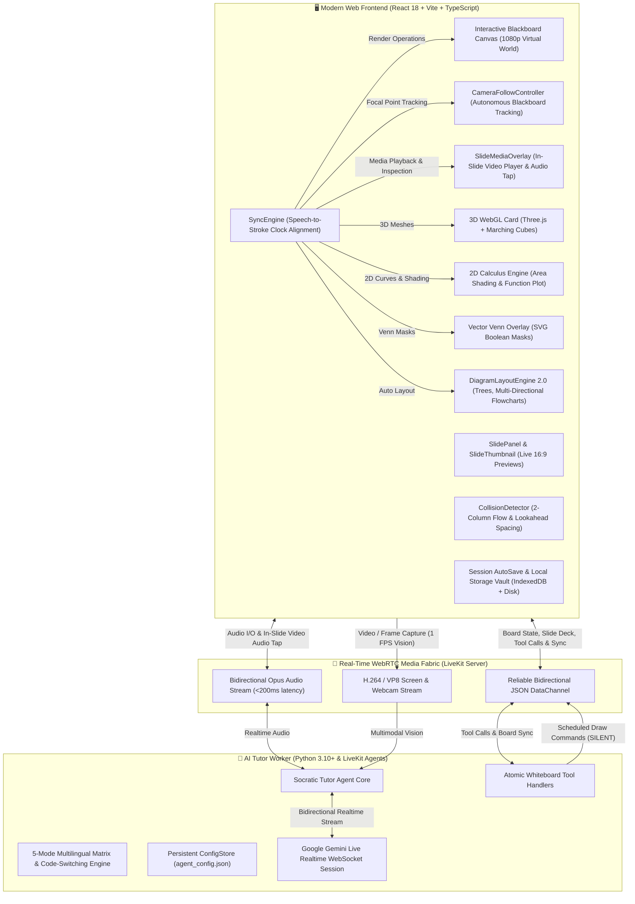

# 🎓 ZYREN AI Tutor — Real-Time Multimodal Socratic Learning Platform

<div align="center">


<p align="center">
  <b>A state-of-the-art, real-time Socratic AI tutoring workstation combining bidirectional low-latency voice streaming, autonomous blackboard camera tracking, computer vision perception, multi-slide live thumbnails, deterministic multi-directional diagrams, vector Venn diagrams, interactive in-slide media with video inspection, and a cutting-edge 3D WebGL Marching Cubes geometry engine.</b>
</p>

[Key Features](#-key-features) • [Architecture](#-system-architecture) • [3D & Geometry Engine](#-3d-mathematical-geometry-engine) • [Quick Start](#-quick-start) • [Configuration](#-configuration) • [Testing & Quality Assurance](#-testing--quality-assurance)

</div>

---

## 🌟 Overview

**ZYREN AI Tutor** is an autonomous, real-time pedagogical pair-learning workstation engineered for university and advanced secondary education across Mathematics, Physics, Computer Science, Engineering, Medicine, and Humanities.

Unlike conventional chatbots or disjointed speech interfaces, **AI Tutor** acts as a genuine classroom instructor standing in front of a digital blackboard:
- **Speaks and Listens Simultaneously**: Full-duplex conversation with zero awkward pauses, immediate interruptibility, and 30 distinct vocal personas powered by Google Gemini Live Realtime.
- **Autonomous Blackboard Camera Tracking**: Intelligently tracks the tutor's live handwriting, formulas, and diagrams, smoothly framing the active learning focal point without disrupting user zoom.
- **Multimodal Video & Document Perception**: Sees student screen-shares, webcams, pasted assignment snapshots, high-resolution slide images, and HTML5 video lectures with frame-accurate timecode inspection.
- **Dynamic Board Drawing & Auto-Layout**: Real-time chalk handwriting, step-by-step LaTeX formula typesetting, interactive 2D calculus curves with shaded definite integrals, multi-directional flowcharts (supporting ascending loops), vector Venn diagrams, and interactive 3D WebGL solids with orbit controls.
- **Socratic Pedagogical Scaffolding**: Built around the Socratic method and cognitive code-switching — guiding students turn-by-turn with targeted micro-steps rather than handing out unearned answers.
- **Multimodal Speech Stability Benchmark & Language Hierarchy**: Configure primary and ordered secondary languages with official Google Gemini Live acoustic stability calibration.

---

## 🏛 System Architecture

The platform runs as a coordinated tripartite system managed by an autonomous Python launcher (`main.py`):



### ⚡ Unified Orchestrator (`main.py`)
Launch the entire ecosystem with a single terminal command:
```bash
python main.py
```
`main.py` automatically:
1. Validates `.env` and checks for your `GEMINI_API_KEY` (or prompts onboarding via the In-App Vault).
2. Launches the local **LiveKit WebRTC Server** (`--dev` mode on port `7880`).
3. Starts the **Python Voice Agent** worker in its isolated virtual environment with live auto-reload and settings change tracking.
4. Boots the **Vite Dev Server** (port `5173`) and checks dependencies.
5. Launches the app in standalone desktop app window mode (`--app` via Edge/Chrome) or default browser.
6. Gracefully terminates all background sub-processes on `Ctrl+C`.

---

## ✨ Key Features

### 🎙️ 1. Ultra-Low Latency Conversational Voice & Extended Thinking
- **Gemini Live Realtime Streaming**: Instant conversational turn-taking with sub-second response times.
- **Dynamic Mid-Session Model Switcher**:
  - `gemini-3.8-live-extended-thinking` (Configurable thinking levels: `minimal`, `low`, `medium`, `high`)
  - `gemini-3.8-live` (Ultra-low latency streaming voice & native tool execution)
  - `gemini-3.1-flash-live-preview` (Agile multimodal preview with thinking depth)
- **Zero-Disconnection Voice Switching**: Audition and switch between **30 Gemini vocal personas** (Aoede, Puck, Charon, Kore, Fenrir, Zephyr, etc.) mid-call with instant audio preview playback and favorites filtering.
- **Simultaneous Action & Speech Protocol**: Whiteboard tool calls are emitted concurrently at the exact first word of explanation; zero verbal filler promises (*"سأكتب ذلك على السبورة"*) and zero retroactive narrations (*"وها قد كتبتها"*).
- **Learner & Tutor Name Personalization**: Configure your student name as well as a custom teacher name in the Persona settings (defaulting to **Zyren**). The AI Tutor adopts this identity when introducing itself and addresses you warmly by your student name. Stored strictly in local device storage (`localStorage`) with runtime WebRTC injection to preserve git privacy.
- **Turn-0 Memory Reset**: Hard reset of Gemini Live WebSocket and agent memory without reloading the page.

### 🌐 2. Multilingual Hierarchy & Speech Stability Benchmark
- **Speech Language Priority Configuration (`LanguageSelectorModal`)**:
  - **Primary Conversational Language**: Select the base instructional language (Egyptian Arabic, Standard Arabic, English, German, French, Spanish, etc.).
  - **Secondary Languages Priority Hierarchy**: Add, remove, and reorder secondary languages (`Priority #1`, `Priority #2`, etc.) for terminology, definitions, and code-switching.
- **Official Google Gemini Live Stability Calibration**:
  - 🟢 **1 Language**: Ultra-Stable (Optimal) — Maximum acoustic accuracy, zero switching latency, 100% deterministic speech recognition.
  - 🔵 **2 Languages**: Highly Stable (Recommended) — Seamless bilingual code-switching; pairing with English provides highest stability.
  - 🟡 **3 Languages**: Moderate Stability — Functional with strict secondary hierarchy; minor chance of acoustic overlap.
  - 🔴 **4+ Languages**: Experimental / Low Stability — Elevated risk of phonetic drift and voice accent bleeding.
- **Single Exclusive Accessibility Lifeline**: If a student indicates they cannot understand the active language, the tutor replies with a single rescue sentence pointing to the 🌐 language button on the toolbar, then immediately resumes the active language with strict anti-jailbreak guardrails.
- **Persistent Configuration Store (`agent/config_store.py`)**: Remembers language priorities, active model, vocal tone, verbosity, and learner profile across reboots.

### 🎥 3. Autonomous Blackboard Camera Tracking & Adaptive Auto-Resize (`CameraFollowController`)
- **Smart Focal Point Navigation**: Automatically pans the viewport to follow where the AI Tutor writes on the 1920x1080 canvas.
- **Adaptive Auto-Resize & Auto-Framing (Auto-Fit)**: Dynamically evaluates the bounding box of active multi-node diagrams, multi-column layouts, and wide formulas. If the structure exceeds the safe viewing zone, the camera smoothly and adaptively adjusts both zoom and pan simultaneously so the entire structure fits comfortably on screen without manual zooming.
- **Deadzone-Aware Smooth Framing**: Evaluates a comfortable viewing deadzone ratio (68%) with frame-rate independent exponential LERP decay for jitter-free cinematic motion.
- **Manual Override Freedom**: Student can pan and zoom freely using mouse, touchpad, or touch gestures; auto-follow and auto-resize smoothly yield to user interaction with an automatic cooldown timer.

### 🎬 4. In-Slide Media Studio & Multimodal Deep Perception (`SlideMediaOverlay`)
- **Embedded Slide Images & Videos**: Drag-and-drop or paste images and HTML5 videos directly onto whiteboard slides.
- **Interactive Player Controls**: Timeline scrubbing, play/pause, volume, speed, and frame-stepping directly on the board.
- **Live Video Audio Tap**: WebAudio 16kHz PCM tap streams playing video audio directly to Gemini Live API so the tutor can listen and discuss recorded lectures.
- **Deep Multimodal Inspection (`inspect_slide_media`)**: Autonomous tool allows the tutor to inspect specific slide media, examine small text/equations, and analyze video timeline timestamps (MM:SS).

### 📑 5. Visual Slide Deck, Continuous Auto-Save & Session Pinning
- **Session Pinning & Eviction Immunity (📌)**: Pin essential study sessions to the top of the session manager in both IndexedDB and the AppData disk vault. Pinned sessions are 100% immune to automatic LRU disk eviction and display an amber golden badge.
- **Live 16:9 Thumbnail Strip (`SlidePanel` & `SlideThumbnail`)**: Miniature real-time canvas renderers showing exact shapes, KaTeX equations, and handwriting per slide.
- **Local AppData Backend Vault (`zyrenBackendVault.ts`)**: Cross-platform atomic JSON persistence (`%APPDATA%/ZYREN_AI_Tutor` on Windows, `~/Library/Application Support` on macOS, `~/.config` on Linux).
- **Dual IndexedDB + Disk Auto-Save (`sessionAutoSave.ts`)**: Continuous auto-save with live status pill (`✓ Auto-saved`), automatic derivation of smart session titles, and session history manager.
- **Multi-Format Export**: Export entire lessons to multi-page **PDF** or high-resolution **PNG**.

### 📊 6. Deterministic Diagram Engine 2.0 & Canvas Typography
- **`DiagramLayoutEngine 2.0`**:
  - Deterministic auto-layout for concept maps, taxonomy trees, hierarchical flowcharts, and comparison boards.
  - **Multi-Directional Flow**: Step nodes support `flow: 'right'`, `'down'`, `'left'`, and ascending `'up'` (enabling return loops and upward cycles).
  - **Continuous Append Mode**: Seamlessly attaches new step sequences to existing whiteboard nodes (`attachToNode`) with localized collision-free slot allocation.
  - 90° orthogonal elbow connectors eliminating crossing diagonal lines.
- **Canvas Markdown Typography (`RoughJsAdapter.ts`)**:
  - Tokenized parsing of bold (`**text**`), italic/notes (`*text*`), subheaders with colons, and bullet normalization.
  - Zero raw formatting delimiters (`**`, `*`) leaking onto the canvas.
- **Sequential 2-Column Layout with Widow Heading Prevention (`CollisionDetector.ts`)**:
  - Strict two-column gravity flow (Column 1 = 150px, Column 2 = 1000px).
  - Contextual lookahead buffer preventing single-line headings from being orphaned at the bottom of a column.

### 📐 7. Smart 3D WebGL Mathematical Geometry Engine
- **Marching Cubes Volumetric Meshing**: Real-time rendering of implicit quadric surfaces and CSG intersections (e.g. $9 \le x^2 + y^2 + z^2 \le 16$, Steinmetz solids, ellipsoids, hyperboloids).
- **Feature-Preserving Meshing**: Exact sub-voxel zero-crossing root finding and QEF singularity resolution to eliminate floating artifacts and ghost blobs.
- **Parametric Manifolds**: Vector manifold builders for Möbius strips, Toruses, Trefoil knots, and Klein bottles.
- **Solids of Revolution & Extrusions**: Dynamic revolves around $X, Y, Z$ axes and linear bounded extrusions with closed, watertight capped ends.
- **Watertight Clipping Planes**: Real-time cross-section slicing ($x \ge 0, z \le 2$).
- **Isolated 3D OrbitControls**: Pan, rotate, and zoom 3D graphs directly inside their whiteboard cards without disrupting canvas navigation.

### 📈 8. Calculus 2D Graphing with Area Shading & Vector Venn Diagrams
- **2D Calculus Engine**: Interactive Cartesian coordinate system with auto-scaling bounds, definite integral area shading between $f_{\text{top}}(x)$ and $f_{\text{bottom}}(x)$ over $[a, b]$, and Gaussian probability density curves.
- **Vector Venn Diagrams**: High-precision 2-set and 3-set Venn diagrams rendered with native SVG Boolean masking (`<clipPath>`, `<mask />`) and exact geometric centroid label placement.

---

## 📂 Project Structure

```
AI_Tutor/
├── agent/                          # Python AI Tutor Voice Agent & Worker
│   ├── agent.py                    # TutorAgent class, tools & Gemini Live integration
│   ├── config_store.py             # Persistent configuration store (agent_config.json)
│   ├── requirements.txt            # Python dependencies (livekit-agents, google-genai, etc.)
│   └── venv/                       # (Git-ignored) Virtual environment
├── livekit_server/                 # Pre-compiled LiveKit WebRTC Server
│   ├── livekit-server.exe          # Local development binary
│   └── LICENSE                     # Apache 2.0 License
├── public/                         # Public assets & PWA manifest
│   ├── manifest.webmanifest        # Progressive Web App manifest
│   └── favicon.ico                 # App icon
├── scripts/                        # Automation & deployment scripts
│   ├── create-desktop-shortcut.ps1 # Windows desktop shortcut generator
│   └── run.bat                     # Quick launch batch script
├── src/                            # Frontend React 18 + TypeScript Application
│   ├── adapters/                   # Architectural abstraction layers
│   │   ├── canvas/                 # RoughJsAdapter (2D canvas & markdown typography)
│   │   ├── llm/                    # Gemini adapter interfaces
│   │   └── tts/                    # ElevenLabs & TTS preview adapters
│   ├── components/                 # React UI components
│   │   ├── ApiKeyModal.tsx         # In-App Gemini API Key onboarding gate & vault
│   │   ├── ChatDrawer.tsx          # Real-time chat & multimodal file uploader
│   │   ├── FileMenu.tsx            # Save/Open, PDF/PNG export, recent sessions & auto-save
│   │   ├── FloatingVideoPiP.tsx    # Picture-in-Picture webcam & screen video
│   │   ├── LanguageSelectorModal.tsx# Multilingual hierarchy & stability benchmark modal
│   │   ├── ModelSelectorModal.tsx  # Dynamic Gemini Live model & thinking level modal
│   │   ├── PersonaSelectorModal.tsx# Verbosity, vocal tone & learner profile modal
│   │   ├── SlidePanel.tsx          # PowerPoint-style slide sorter drawer
│   │   ├── SlideThumbnail.tsx      # Live 16:9 miniature canvas thumbnail renderer
│   │   ├── ThreeGraph3DCard.tsx    # 3D Three.js card with isolated OrbitControls
│   │   ├── UserDrawingLayer.tsx    # Student freehand annotation canvas
│   │   ├── VoiceSelectorModal.tsx  # 30-voice persona audition & selector modal
│   │   └── Whiteboard.tsx          # Master blackboard workspace orchestrator
│   ├── engine/                     # Core computational & synchronization engines
│   │   ├── AudioClock.ts           # Web Audio clock source & drift calculator
│   │   ├── CameraFollowController.ts# Autonomous blackboard camera tracking controller
│   │   ├── CollisionDetector.ts    # 2-column layout solver & lookahead spacing
│   │   ├── DiagramLayoutEngine.ts  # Deterministic multi-directional diagram auto-layout
│   │   ├── DriftCorrector.ts       # Audio-visual synchronization drift compensator
│   │   ├── InterruptionHandler.ts  # Millisecond vocal interruption recovery
│   │   ├── SyncEngine.ts           # Master render dispatcher & undo/redo stack
│   │   └── SyncQueue.ts            # Priority command queue
│   ├── layers/                     # Canvas visual overlays
│   │   ├── ArabicShaper.ts         # RTL Arabic text shaping & glyph normalization
│   │   ├── CanvasLayer.tsx         # Rough.js sketchy blackboard drawings
│   │   ├── Graph3DOverlay.tsx      # 3D WebGL container overlay
│   │   ├── GraphOverlay.tsx        # 2D coordinate graphs & calculus area shading
│   │   ├── MathOverlay.tsx         # KaTeX LaTeX formula renderer
│   │   ├── SlideMediaOverlay.tsx   # In-slide interactive HTML5 video & image player
│   │   ├── SVGOverlay.tsx          # Stroke-by-stroke animated handwriting
│   │   └── VennOverlay.tsx         # Vector SVG boolean mask Venn diagram engine
│   ├── math3d/                     # Mathematical 3D geometry engine
│   │   ├── builders/               # Surface, revolution, parametric & solid builders
│   │   ├── marchingCubes/          # 3D Marching Cubes algorithm & lookup tables
│   │   ├── astParser.ts            # AST algebraic expression parser
│   │   ├── compiler.ts             # High-speed math function compiler
│   │   ├── expressionGuard.ts      # Math safety & evaluation validator
│   │   ├── implicitResolver.ts     # Implicit-to-explicit equation resolver
│   │   ├── multiBoundarySolver.ts  # Multi-constraint spatial domain solver
│   │   └── router.ts               # 3D plot type routing logic
│   ├── server/                     # Full-stack local backend services
│   │   └── zyrenBackendVault.ts    # Secure AppData vault, API key manager & disk session storage
│   ├── services/                   # Client application services
│   │   └── sessionAutoSave.ts      # Dual IndexedDB + disk continuous auto-save
│   ├── store/                      # Zustand state store
│   ├── transport/                  # LiveKit WebRTC client & DataChannel protocol
│   ├── types/                      # Shared TypeScript type definitions
│   ├── App.tsx                     # Top-level React entrypoint & token lifecycle
│   ├── index.css                   # Global blackboard styling & Tailwind classes
│   └── main.tsx                    # React DOM root
├── tests/                          # Automated test suites (101 passing tests)
│   ├── agent/                      # Pytest backend agent tests (24 tests)
│   │   ├── test_agent.py           # Agent async tool execution
│   │   ├── test_config_store.py    # Persistent JSON configuration store
│   │   ├── test_language_config.py # Multilingual hierarchy & accessibility rescue
│   │   ├── test_media_and_extended_thinking.py # Slide media perception & thinking locks
│   │   ├── test_mlf_instructions.py# Multilingual matrix prompt validation
│   │   └── test_problem7_fixes.py  # Upward diagram flow & speech-action synchronization
│   └── unit/                       # Vitest frontend unit tests (77 tests)
│       ├── diagram_layout.test.ts  # Multi-directional diagrams & append layout (29 tests)
│       ├── graph_shading.test.ts   # 2D calculus area shading test suite (5 tests)
│       ├── new_features.test.ts    # Slide thumbnails, auto-save & media hooks (9 tests)
│       ├── expressionGuard.test.ts # AST math expression safety & validation (12 tests)
│       ├── venn_diagram.test.ts    # VennOverlay boolean masking test suite (14 tests)
│       └── whiteboard_session.test.ts # Session state & serialization test suite (8 tests)
├── .env.example                    # Environment configuration template
├── .gitignore                      # Git exclusion rules
├── index.html                      # HTML template
├── main.py                         # Unified platform launcher script
├── package.json                    # Node dependencies & npm scripts
├── tsconfig.json                   # TypeScript project configuration
└── vite.config.ts                  # Vite build, API middleware & LiveKit token server config
```

---

## 🚀 Quick Start

### 📋 Prerequisites
Ensure your machine has the following installed:
- **Node.js**: v18.0.0 or higher ([Download Node.js](https://nodejs.org/))
- **Python**: v3.10, v3.11, or v3.12 ([Download Python](https://www.python.org/))
- **Google Gemini API Key**: Free or paid key from [Google AI Studio](https://aistudio.google.com/)

---

### 1️⃣ Clone the Repository
```bash
git clone https://github.com/MONaser04/Zyren-AI-Tutor.git
cd Zyren-AI-Tutor
```

### 2️⃣ Configure Environment Variables
Copy the template `.env.example` to `.env`:
```bash
cp .env.example .env
```
Open `.env` in any text editor and insert your Gemini API Key (or configure it directly inside the app via the In-App Key Vault):
```ini
LIVEKIT_URL=ws://127.0.0.1:7880
LIVEKIT_API_KEY=devkey
LIVEKIT_API_SECRET=secret
GEMINI_API_KEY=AIzaSy...your_actual_gemini_api_key...
```

### 3️⃣ Install Dependencies

#### Frontend (Node.js)
```bash
npm install
```

#### Voice Agent (Python)
It is recommended to use a virtual environment:
```bash
# Create virtual environment inside agent folder
python -m venv agent/venv

# Activate virtual environment
# Windows (PowerShell):
agent\venv\Scripts\Activate.ps1
# Windows (CMD):
agent\venv\Scripts\activate.bat
# Linux / macOS:
source agent/venv/bin/activate

# Install required Python packages
pip install -r agent/requirements.txt
```

---

### 4️⃣ Launch AI Tutor!
Start all services (LiveKit Server + Python Voice Agent + Vite Frontend) with a single command:
```bash
python main.py
```
*Windows users can also double-click `scripts/create-desktop-shortcut.ps1` to place a standalone native desktop app icon on their desktop.*

The launcher initializes all components, verifies LiveKit health, connects the Gemini Realtime session, and opens the application window:
```
http://localhost:5173
```
To run on a tablet, iPad, or mobile phone on the same Wi-Fi network, access the LAN URL printed in the console (e.g., `http://192.168.1.X:5173`).

---

## ⚙️ Environment Configuration

| Variable | Default Value | Description |
|---|---|---|
| `LIVEKIT_URL` | `ws://127.0.0.1:7880` | WebSocket URL of the LiveKit WebRTC server (`wss://...` for LiveKit Cloud). |
| `LIVEKIT_API_KEY` | `devkey` | LiveKit API Key (`devkey` for local development). |
| `LIVEKIT_API_SECRET` | `secret` | LiveKit API Secret (`secret` for local development). |
| `GEMINI_API_KEY` | *(Configurable in UI or .env)* | Google Gemini API Key from [Google AI Studio](https://aistudio.google.com/). |
| `ZYREN_APPDATA_DIR` | *(OS AppData default)* | Custom directory for session snapshots, media files, and settings. |

---

## 🧪 Testing & Quality Assurance

AI Tutor enforces strict quality assurance with **109 automated passing tests** across both frontend and backend layers:

### 1. Frontend Test Suite (Vitest — 83 Tests)
Executes 83 unit tests validating multi-directional diagram layouts, adaptive auto-resize transforms, session pinning, SVG Venn masks, 2D calculus area shading, slide thumbnail generation, session persistence, and AST math expression safety:
```bash
npm test
```
```
 ✓ tests/unit/diagram_layout.test.ts (29 tests)
 ✓ tests/unit/venn_diagram.test.ts (14 tests)
 ✓ tests/unit/new_features.test.ts (13 tests)
 ✓ tests/unit/expressionGuard.test.ts (12 tests)
 ✓ tests/unit/whiteboard_session.test.ts (8 tests)
 ✓ tests/unit/graph_shading.test.ts (5 tests)

 Test Files  6 passed (6)
      Tests  83 passed (83)
```

### 2. Backend Agent Test Suite (Pytest — 26 Tests)
Validates asynchronous tool calls, persistent JSON config stores, student name personalization without git leaks, language hierarchy and accessibility lifelines, slide media perception, and upward diagram flow:
```bash
# In active Python virtual environment:
pytest tests/agent/
```
```
collected 26 items
tests/agent/test_agent.py .                                              [  4%]
tests/agent/test_config_store.py ..                                      [ 12%]
tests/agent/test_language_config.py .........                            [ 48%]
tests/agent/test_media_and_extended_thinking.py ....                     [ 64%]
tests/agent/test_mlf_instructions.py .                                   [ 68%]
tests/agent/test_problem7_fixes.py ........                              [100%]

============================= 26 passed in 6.85s =============================
```

### 3. Frontend Production Build Check
```bash
npm run build
```
Validates full TypeScript typing (`tsc -b`) and bundles production assets via Vite with zero errors.

---

## 🤝 Contributing

Contributions are welcomed! Follow these steps to contribute:
1. **Fork the repository** on GitHub.
2. **Create a feature branch**:
   ```bash
   git checkout -b feature/amazing-feature
   ```
3. **Commit your changes** using conventional commits:
   ```bash
   git commit -m "feat: Add interactive geometry compass tool"
   ```
4. **Push to the branch**:
   ```bash
   git push origin feature/amazing-feature
   ```
5. **Open a Pull Request**.

---

## 📜 License

This project is licensed under the [MIT License](LICENSE).

The LiveKit Server binary included in `livekit_server/` is distributed under the [Apache License 2.0](https://www.apache.org/licenses/LICENSE-2.0).

---

<div align="center">
  <sub>Engineered with precision for autonomous AI-assisted learning. Built with Google Gemini Live & LiveKit.</sub>
</div>
